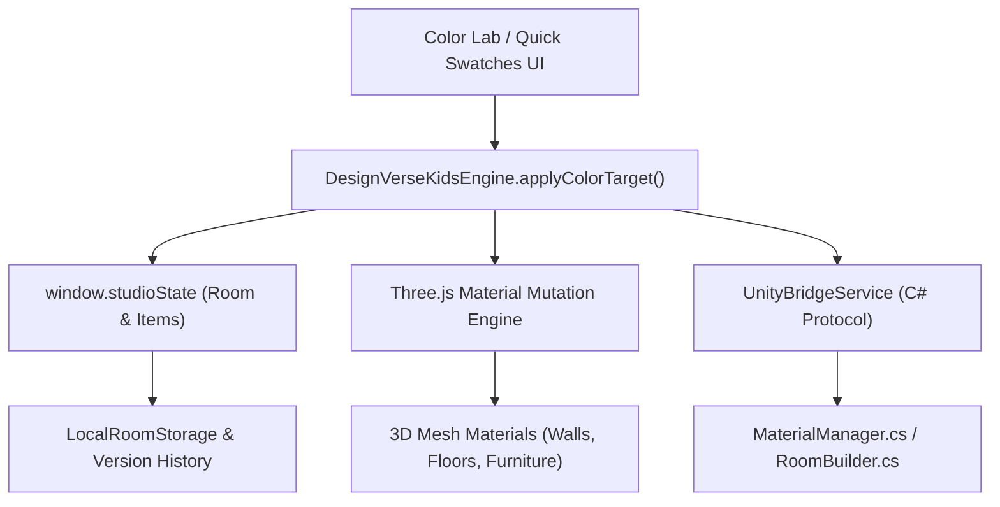

# 🎨 COLOR SYSTEM — 2D & 3D MATERIAL COLORING ARCHITECTURE

## Product
**DesignVerse Kids** — Interior Design Learning & Creativity Platform  
**Subsystem:** Real 2D/3D Material Coloring & Color Lab Engine

---

## 1. Architectural Overview
The Color System enables children to apply colors learned in Level 3 directly to real 3D objects and spatial boundaries. There is **no fake rendering or mockup overlay**: every color mutation dynamically updates Three.js scene mesh materials and Unity GameObjects in real time, while updating the persistent scene graph (`window.studioState`).



---

## 2. Real Three.js Material Mutation Pipeline

### Target Resolution
When a child or lesson selects a target for recoloring, the engine handles 3 target categories:
1. **Room Walls (`target = 'walls'`)**:
   - Queries all wall meshes in `window.studioThreeScene` or `wallGroup`.
   - Mutates `mesh.material.color.set(hex)`.
   - Synchronizes `window.studioState.room.wallColor = hex`.
2. **Room Floor (`target = 'floor'`)**:
   - Queries floor mesh in the scene.
   - Mutates `floorMesh.material.color.set(hex)`.
   - Synchronizes `window.studioState.room.floorColor = hex`.
3. **Selected or Specific Furniture (`target = itemId || 'selected'`)**:
   - Locates item in `window.studioState.items`.
   - Traverses the Three.js `Group` or `Mesh` hierarchy recursively:
     ```javascript
     object3D.traverse((child) => {
       if (child.isMesh && child.material) {
         if (Array.isArray(child.material)) {
           child.material = child.material.map(m => m.clone());
           child.material.forEach(m => m.color.set(hex));
         } else {
           child.material = child.material.clone();
           child.material.color.set(hex);
         }
       }
     });
     ```
   - Clones materials before mutation so other furniture instances of the same model are not mutated unintentionally.
   - Updates `item.color = hex` in `window.studioState`.

---

## 3. Unity 3D C# Integration Protocol
For Unity native builds (`unity/DesignVerse`), color changes dispatch JSON bridge events:
```json
{
  "command": "SET_OBJECT_COLOR",
  "data": {
    "target": "furniture_sofa_01",
    "colorHex": "#3A86FF"
  }
}
```
In C#, `MaterialManager.cs` processes this message:
```csharp
public void SetObjectColor(string objectId, Color color) {
    if (spawnedObjects.TryGetValue(objectId, out GameObject obj)) {
        Renderer[] renderers = obj.GetComponentsInChildren<Renderer>();
        foreach (var r in renderers) {
            r.material.color = color;
        }
    }
}
```

---

## 4. Interactive Color Mixing Engine
The Color Lab provides an interactive mixing station implementing subtractive RYB blending tailored for children:

| Color A | Color B | Resulting Color | Name | Child Meaning |
| :--- | :--- | :--- | :--- | :--- |
| 🔴 `#FF5964` (Red) | 🟡 `#FFB703` (Yellow) | 🟠 `#FB8500` | Orange | Energy, Citrus & Warmth |
| 🔵 `#3A86FF` (Blue) | 🟡 `#FFB703` (Yellow) | 🟢 `#06D6A0` | Green | Fresh Nature & Balance |
| 🔴 `#FF5964` (Red) | 🔵 `#3A86FF` (Blue) | 🟣 `#8338EC` | Purple | Magical, Cozy & Royal |
| ⚪ `#FFFFFF` (White) | 🔴 `#FF5964` (Red) | 🌸 `#FFAAA6` | Coral Tint | Soft Pastel Warmth |
| ⚪ `#FFFFFF` (🔵 Blue) | 🔵 `#3A86FF` (Blue) | ❄️ `#A0C4FF` | Sky Pastel | Peaceful Sleep Atmosphere |

---

## 5. Curated Child-Safe Color Palettes
The system provides 5 curated, harmonious palettes that children can apply with one tap to transform their rooms:

1. **☀️ Warm Sunshine (Energetic)**:
   - Primary: `#FFB703` (Sun Yellow)
   - Accent: `#FB8500` (Tangerine)
   - Base: `#FFF3B0` (Cream Wall)
   - Best For: Playrooms, activity centers.
2. **🌊 Ocean Breeze (Calming)**:
   - Primary: `#3A86FF` (Sky Blue)
   - Secondary: `#4CC9F0` (Lagoon Aqua)
   - Base: `#F0F8FF` (Soft Mist)
   - Best For: Bedrooms, quiet reading.
3. **🌿 Mint Garden (Fresh & Focused)**:
   - Primary: `#06D6A0` (Mint Green)
   - Secondary: `#38B000` (Leaf Green)
   - Base: `#E8F5E9` (Sage Cream)
   - Best For: Study desks, homework areas.
4. **🦄 Berry Magic (Creative & Fun)**:
   - Primary: `#8338EC` (Magic Purple)
   - Secondary: `#F72585` (Berry Pink)
   - Base: `#F3E8FF` (Lavender White)
   - Best For: Creative art corners.
5. **🪵 Cozy Earth (Warm & Grounded)**:
   - Primary: `#8D5B4C` (Natural Wood)
   - Secondary: `#DDA15E` (Warm Sand)
   - Base: `#FAF0CA` (Vanilla Wall)
   - Best For: Living rooms and shared spaces.

---

## 6. Accessibility & Contrast Safeguards
- All text over dynamic swatches automatically switches between `#FFFFFF` and `#111111` based on calculated luminance ($L = 0.299R + 0.587G + 0.114B$).
- High color contrast is guaranteed so children with color vision differences can distinguish objects by both color and friendly emoji labels.
- Sound chimes accompany each color application to provide multi-sensory validation.
